# Cloud SOC with Microsoft Sentinel

A hands-on cloud security operations project. I stand up **Microsoft Sentinel** as a cloud SIEM on Azure, connect it to live Azure activity, simulate attacker behaviour, write a custom **KQL** detection rule mapped to MITRE ATT&CK, and work the resulting incident the way a SOC analyst would, down to the raw log line that triggered it. I then build a small workbook (dashboard) on top.

This is the cloud counterpart to my on-prem lab, where I ran Wazuh as the SIEM. The point of doing both is to be able to speak to on-prem and cloud SIEM work, and to explain when each fits.

**What this project demonstrates in one line:** I built a working cloud SOC from an empty subscription, detected a simulated destructive action with a rule I wrote, traced the incident back to the exact resource and caller, and learned first-hand where cloud security events do and do not land.

---

## Skills demonstrated

- **Cloud SIEM:** Microsoft Sentinel onboarding, Log Analytics workspace design, data connectors, Content hub solutions
- **KQL (Kusto Query Language):** ad-hoc investigation queries, aggregation, time-binning, detection logic
- **Detection engineering:** scheduled analytics rules, entity mapping, alert thresholds, MITRE ATT&CK tagging, incident creation
- **Azure platform:** resource groups, Azure Policy (DeployIfNotExists with remediation), managed identities, Azure RBAC, Privileged Identity Management (PIM)
- **Incident analysis:** reading an incident, pivoting on entities, validating a detection against raw evidence
- **Visualization:** custom Sentinel workbook with time-series, table and categorical views
- **Operational judgment:** cost control on a student subscription, region policy constraints, ingestion latency, log-source coverage

---

## Architecture

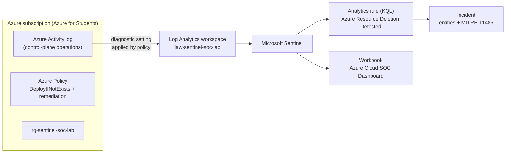

| Component | Purpose |
|-----------|---------|
| Resource group `rg-sentinel-soc-lab` | One container for the whole lab, so teardown is a single delete |
| Log Analytics workspace `law-sentinel-soc-lab` | The log store Sentinel sits on; queried with KQL |
| Microsoft Sentinel | The SIEM layer: connectors, analytics rules, incidents, workbooks |
| Azure Activity connector | Streams subscription-level operations (create, delete, policy, role changes) into the workspace |

**How this maps to the on-prem lab:** the Log Analytics workspace plays the role the Wazuh indexer played (storage and search), and Sentinel plays the role of the Wazuh manager and dashboard (detection and analysis). Same two-part structure, different operating model: Wazuh is self-hosted and free, Sentinel is a managed service billed by ingestion and tightly integrated with the Microsoft identity stack.

---

## The build

### 1. Workspace and Sentinel

I created the resource group, then the Log Analytics workspace, then enabled Sentinel on it. Sentinel is not a separate resource you drop next to the workspace; it is a capability you switch on **for** a workspace, which is why it asks you to pick one.

Sentinel activated its **31-day free trial** (up to 10 GB/day for both Sentinel and Log Analytics), which comfortably covers a lab like this.

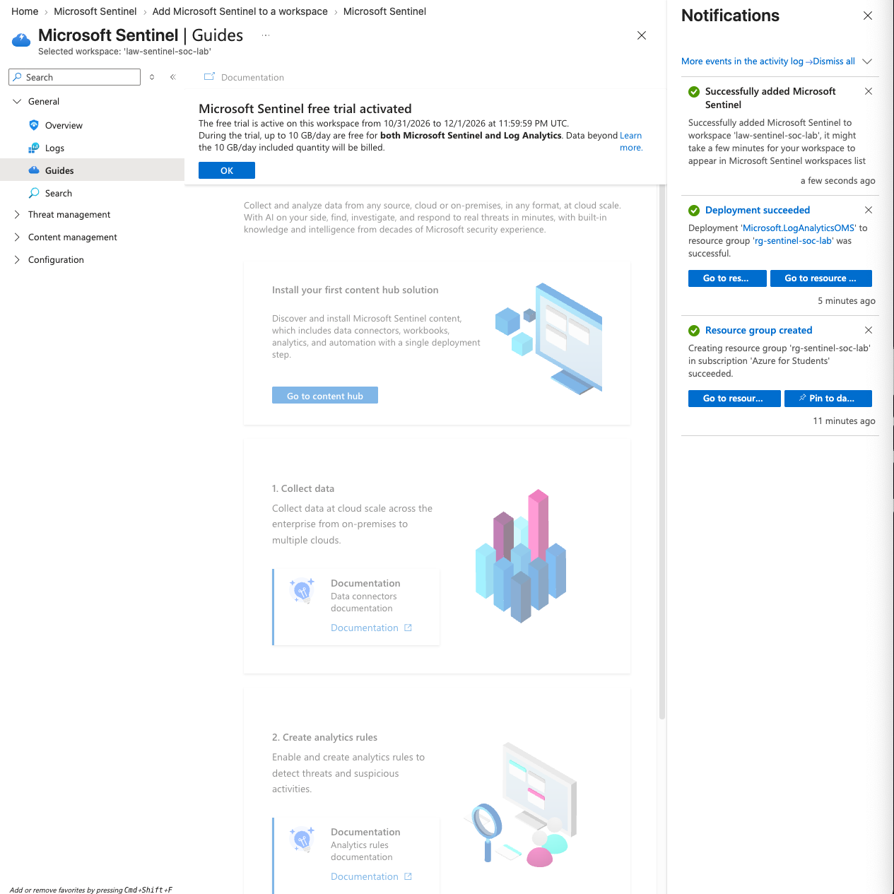

**A real constraint worth noting:** the student subscription enforces an Azure Policy restricting which regions can host resources. My first workspace attempt in Canada East failed validation; Canada Central was permitted. Reading the policy error rather than guessing saved time, and keeping data in Canada is a nice detail for Canadian public-sector roles.

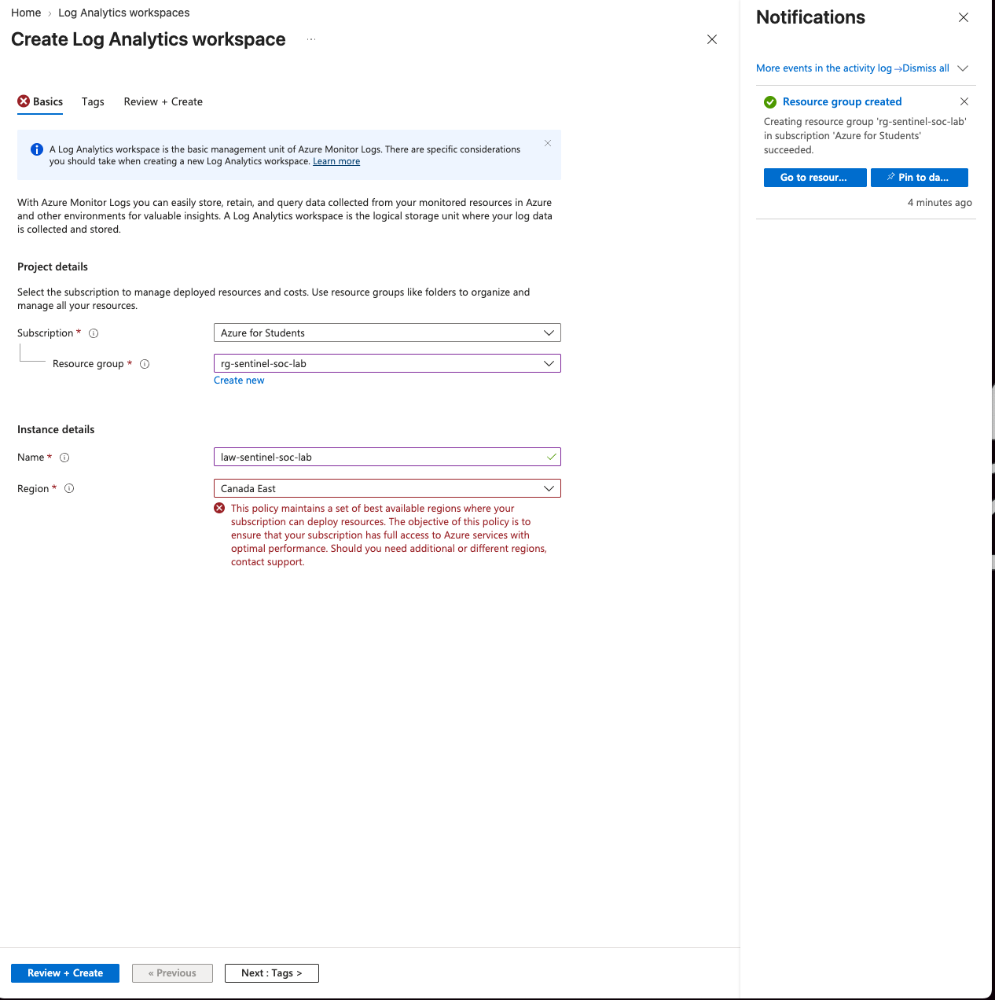

### 2. Connecting Azure Activity

From the Content hub I installed the **Azure Activity** solution (connector, analytics rule templates, hunting queries, workbooks). The modern connector does not use a per-subscription toggle; it is governed by **Azure Policy**: an assignment of *Configure Azure Activity logs to stream to specified Log Analytics workspace*, scoped to the subscription, with a **remediation task** and a **system-assigned managed identity** so it applies immediately and keeps future subscriptions in scope compliant.

After roughly 15 minutes the connector flipped to **Connected** and the first events arrived.

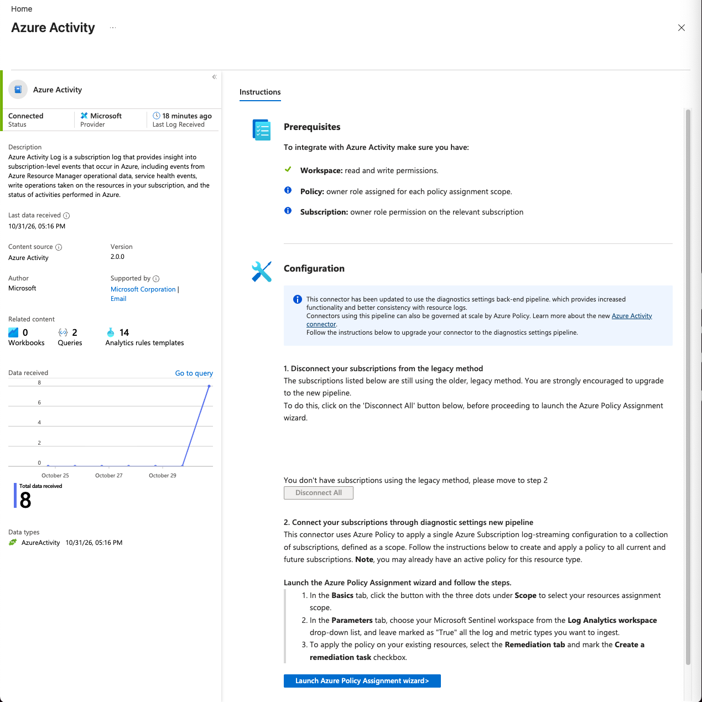

### 3. First KQL query

With data flowing, the first thing to do in any SIEM is look at what is actually there:

```kql
AzureActivity
| sort by TimeGenerated desc
| take 20
```

The first rows were my own footprints: policy assignment, resource deployments, diagnostic settings being written. Benign, but exactly the kind of baseline you want before writing detections.

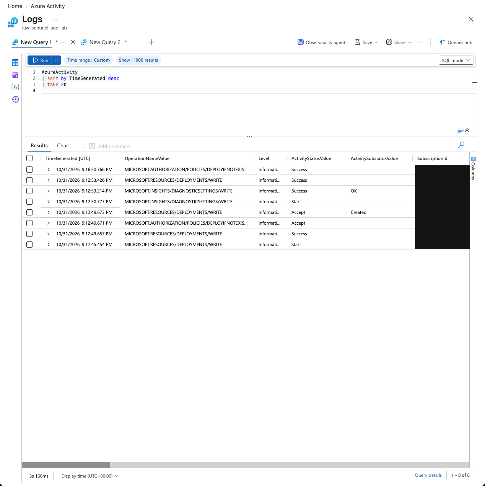

---

## Simulating attacker activity

I wanted two kinds of events: a **privilege change** and a **destructive action**.

### Privilege change (and a lesson about where events live)

I assigned the **Reader** role to an account at the resource-group scope, the cloud equivalent of adding someone to a group in Active Directory. The tenant has **Privileged Identity Management (PIM)** enabled, so instead of a standing assignment Azure created an **eligible, time-bound** one: the account must activate the role when needed, for a limited window. That is just-in-time access, and it is the same model I used daily in a previous role, activating admin roles each day rather than holding them permanently.

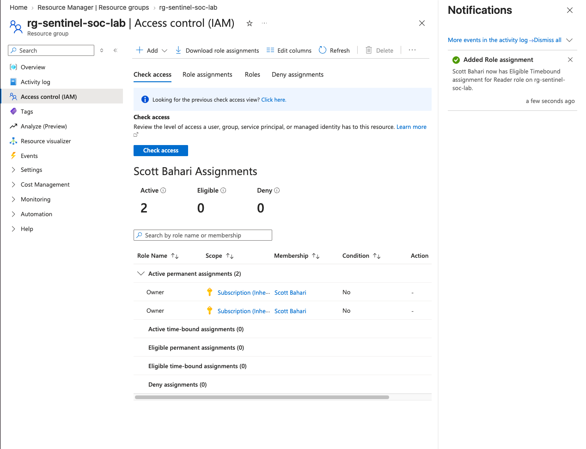

Then I went looking for it in the SIEM and, at first, it was not there:

```kql
AzureActivity
| where OperationNameValue has "Authorization"
| sort by TimeGenerated desc
```

Only my earlier policy operations came back. The classic `Microsoft.Authorization/roleAssignments/write` event I expected never appeared, because a PIM eligibility is an **identity** operation that is primarily recorded in the Entra ID audit log (the `AuditLogs` table), fed by the Microsoft Entra ID connector, which requires an Entra ID P1/P2 licence this subscription does not have.

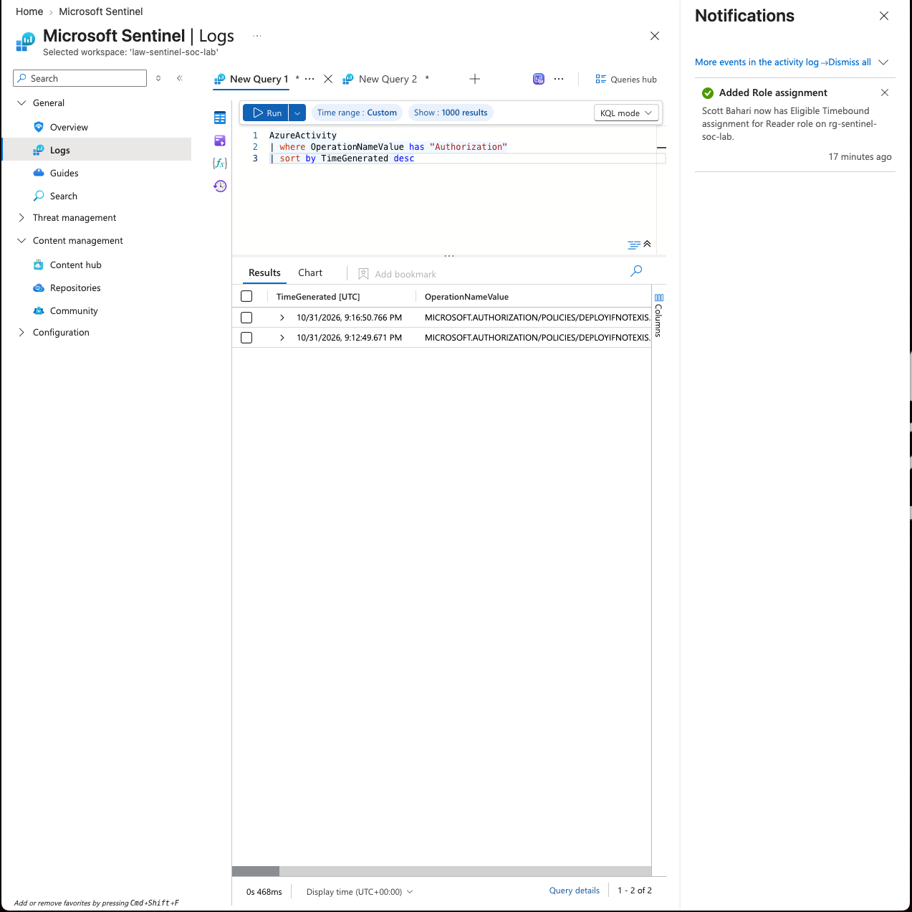

**Lesson:** a detection is only as good as whether its data actually flows to the table you are querying. Identity events and resource events live in different places, and PIM operations even carry different operation names. (The event did later surface in the resource log under a PIM-specific name, *Add eligible member to role*, which shows up in the dashboard at the end. That confirms the point rather than contradicting it: query by what the platform actually logs, not by what you assume it logs.)

### Destructive action

For the detection itself I used an event that reliably lands in `AzureActivity`: I created a throwaway resource group, `rg-test-delete`, and deleted it. Resource deletion is a real threat pattern (sabotage, ransomware impact, an attacker removing infrastructure or evidence) and maps to **MITRE ATT&CK T1485, Data Destruction**.

---

## The detection: a scheduled analytics rule

I wrote the rule in the Sentinel analytics wizard.

**General:** name *Azure Resource Deletion Detected*, severity Medium, MITRE tactic **Impact**, technique **T1485**.

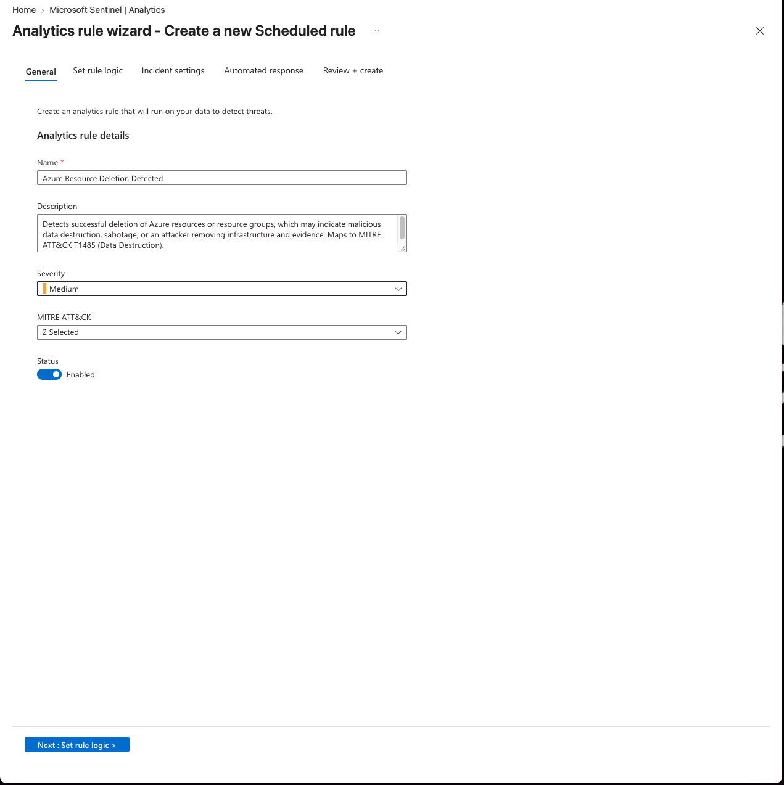

**Rule logic:**

```kql
AzureActivity
| where OperationNameValue endswith "/delete"
| where ActivityStatusValue == "Success"
| project TimeGenerated, Caller, CallerIpAddress, OperationNameValue, ResourceGroup, _ResourceId
```

- **Entity mapping:** `Caller` mapped to an **Account** entity, `CallerIpAddress` to an **IP** entity, so every incident immediately answers "who" and "from where" without extra digging.
- **Scheduling:** run every **5 minutes**, look back **1 hour**.
- **Threshold:** alert when results are greater than 0.
- **Incident settings:** create incidents from alerts.

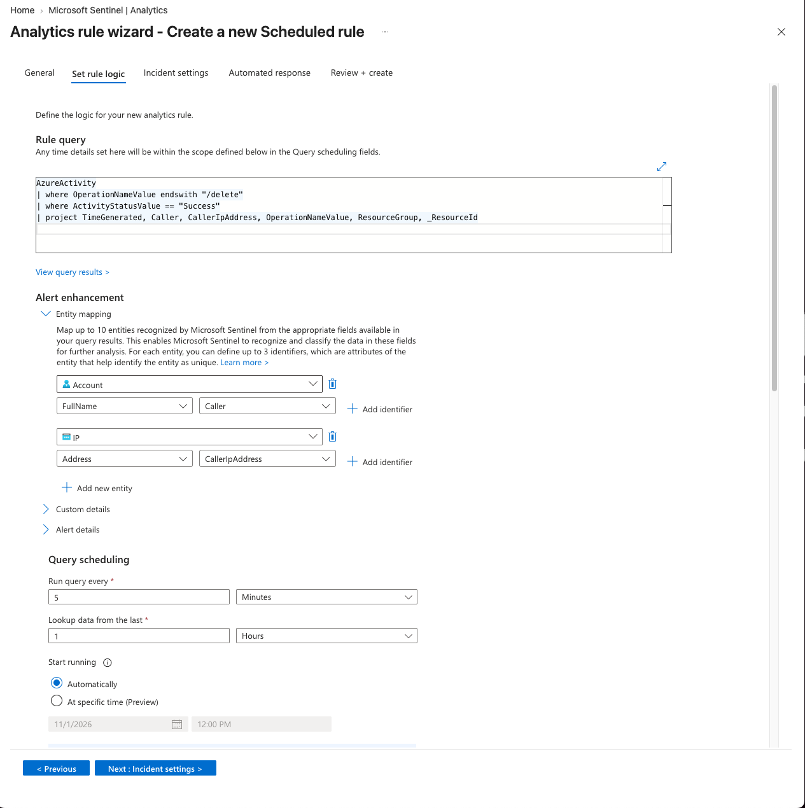

The rule's results simulation showed zero at creation time, because the deletion event had not finished ingesting yet. That is normal for Azure Activity (15 to 30 minutes end to end), and it is why the rule is scheduled rather than run once: it picked the event up on a later run on its own.

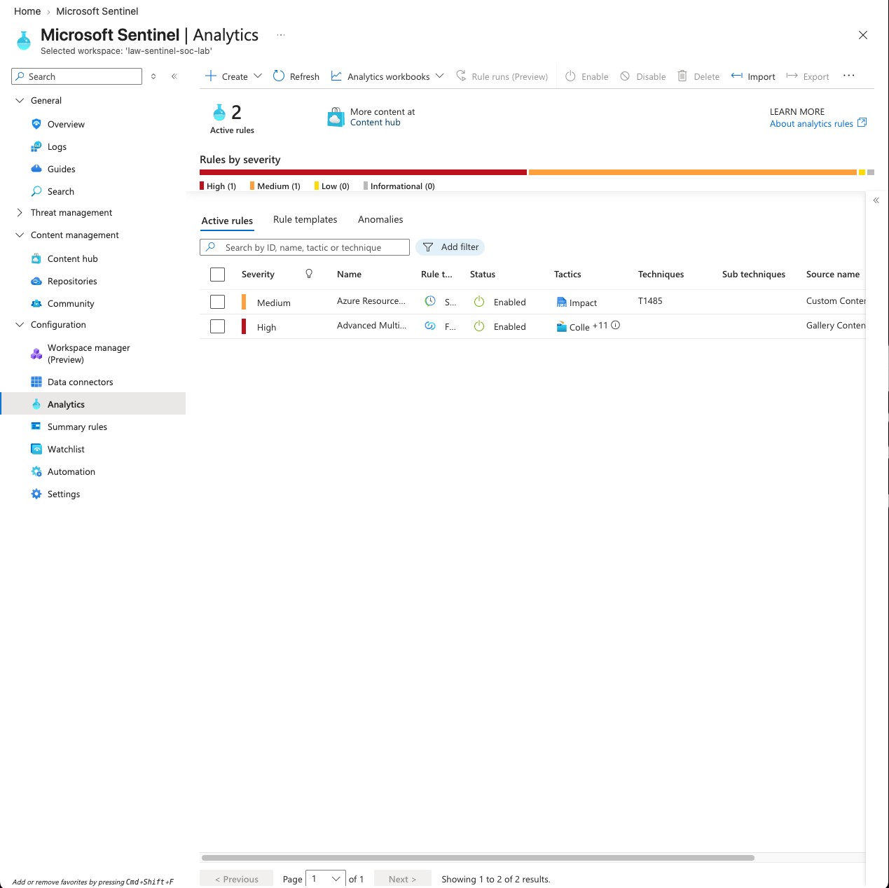

---

## The incident

Minutes later Sentinel raised **Incident 1: Azure Resource Deletion Detected**, Medium severity, with two entities (the account and the IP it came from) and the T1485 technique attached.

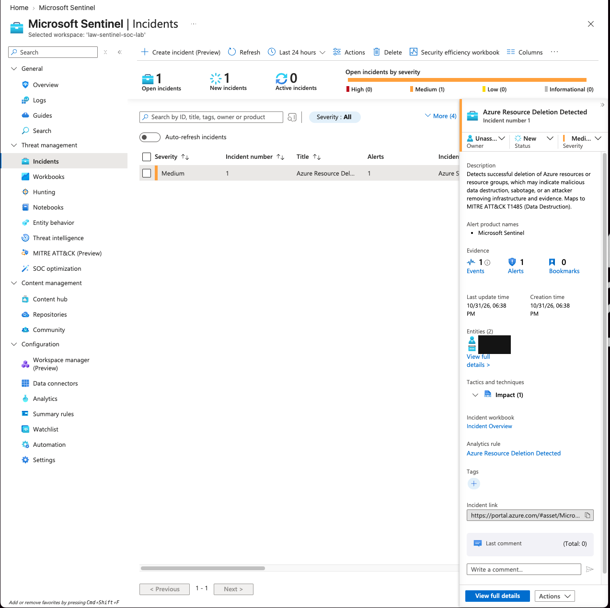

Opening it shows the analyst's view: the timeline entry stamped at the exact second of the deletion, the mapped entities, the tactic and technique, and the link back to the rule that fired.

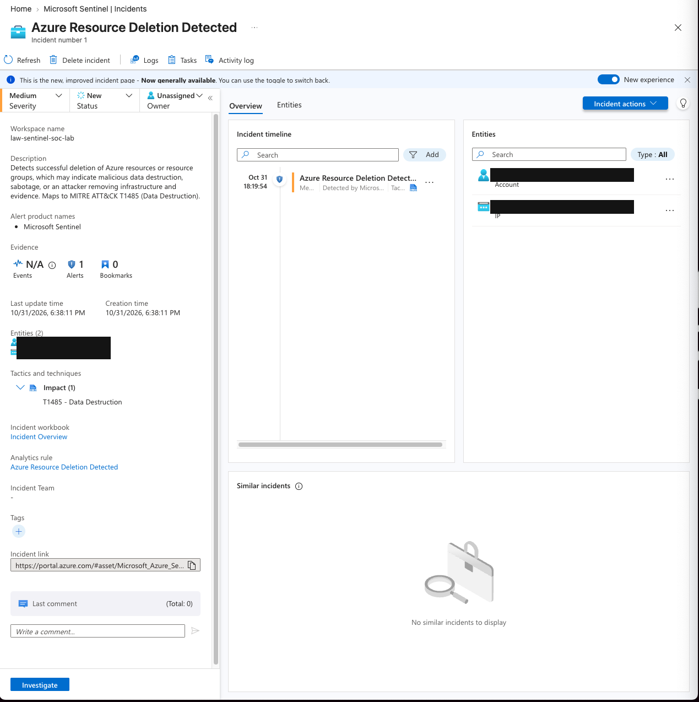

### Validating against the evidence

An incident summary tells you a deletion happened; it does not, by itself, name the resource. So I went back to the raw log to confirm the rule caught the right thing:

```kql
AzureActivity
| where OperationNameValue endswith "/delete"
| where ActivityStatusValue == "Success"
| project TimeGenerated, Caller, OperationNameValue, ResourceGroup, _ResourceId
```

The event is `MICROSOFT.RESOURCES/SUBSCRIPTIONS/RESOURCEGROUPS/DELETE` on `RG-TEST-DELETE`, by the expected caller, at the expected time.

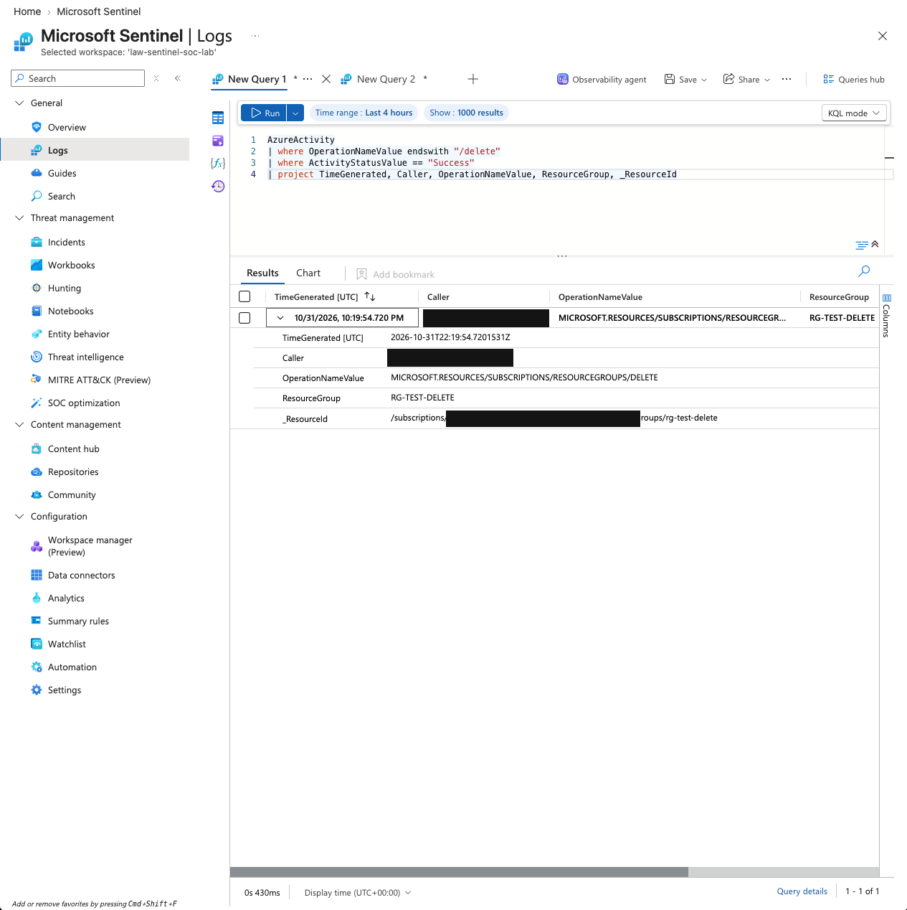

**A small gotcha that cost a minute:** the Logs blade had been left on a narrow custom time range from an earlier connector page, so this query first returned nothing. Widening the range to the last 4 hours surfaced the event. Always check the time picker before concluding data is missing.

---

## The dashboard

I built a custom workbook, **Azure Cloud SOC Dashboard**, with three tiles:

1. **Azure Activity Volume (per hour)**, a time chart of overall operation count, the "pulse" of the environment.
2. **Resource Deletions Detected (T1485)**, a table driven by the same logic as the detection rule.
3. **Operations by Type (last 24h)**, a bar chart of operations grouped by name, which is how you spot an unusual spike in a particular kind of action.

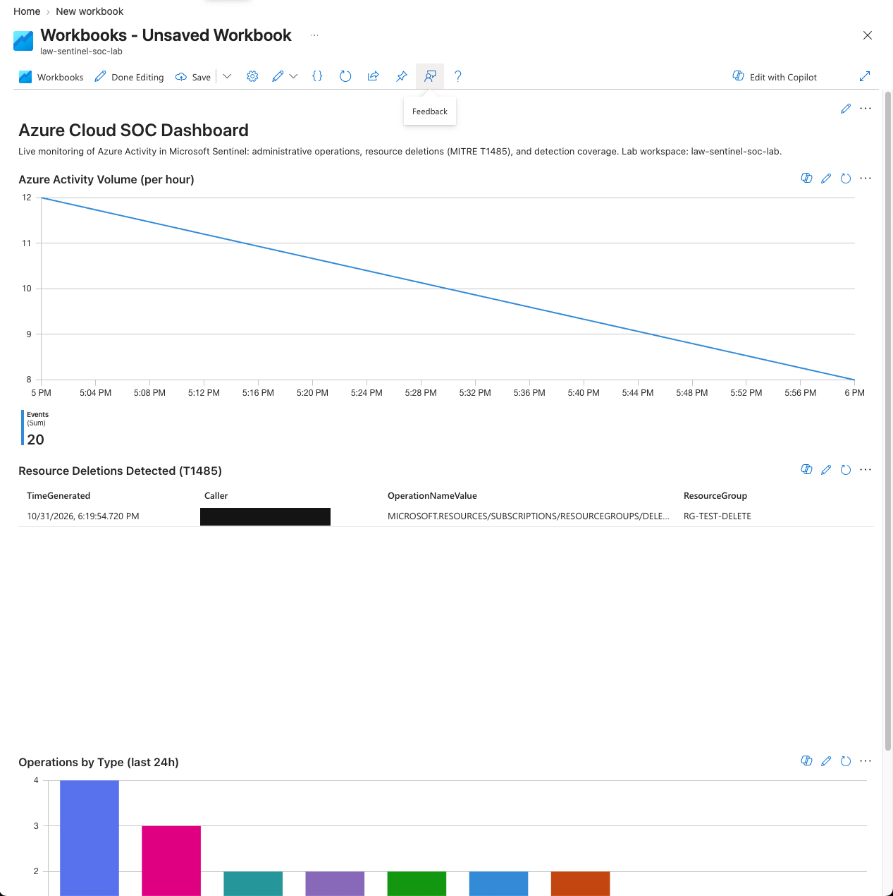

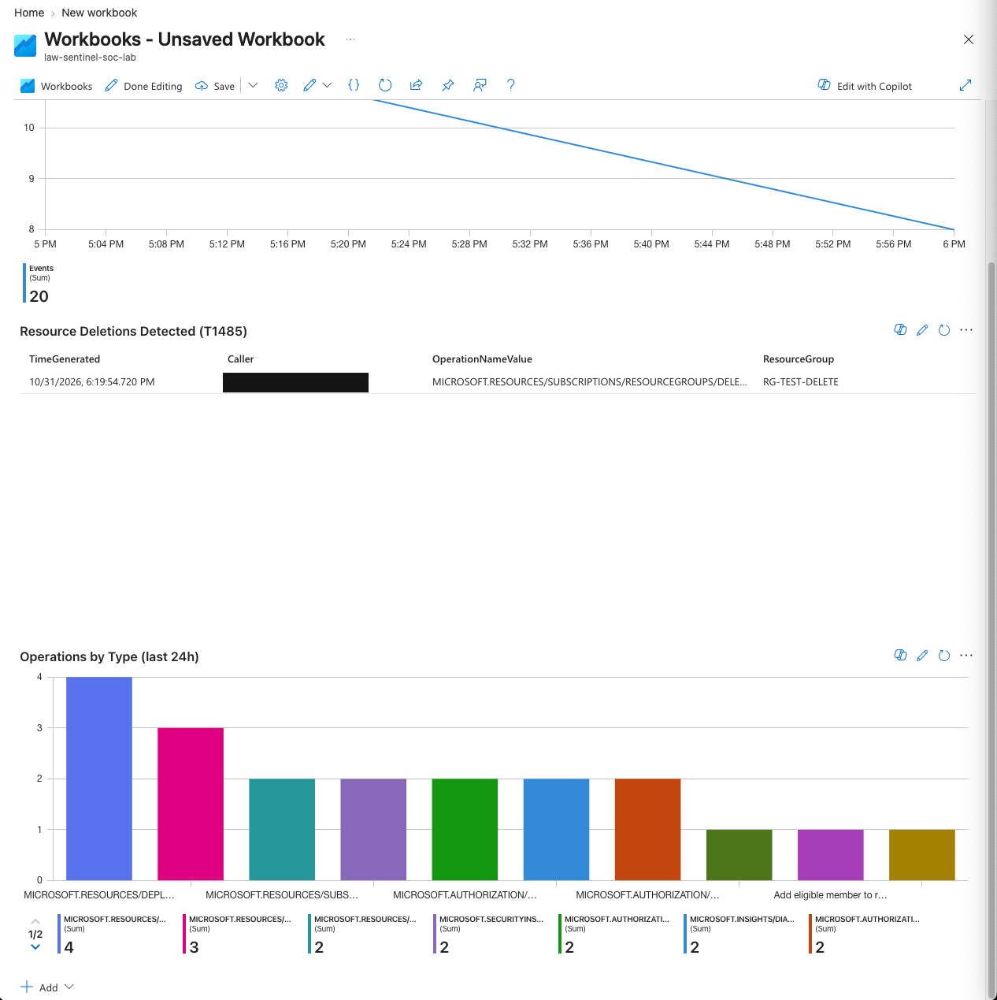

The bar chart is also where the PIM assignment finally showed itself, under *Add eligible member to role*, which closed the loop on the earlier lesson.

---

## On-prem SIEM vs cloud SIEM: what I can now speak to

| | Wazuh (on-prem lab) | Microsoft Sentinel (this project) |
|---|---|---|
| Hosting | Self-hosted; I run the manager, indexer and dashboard | Fully managed by Microsoft |
| Cost model | Free and open source; you pay in operations effort | Billed per GB ingested; free trial and student credit here |
| Rule language | XML rules and decoders | KQL analytics rules |
| Collection | Agents on each host, syslog | Connectors, Azure Policy, agents for VMs, API connectors for other clouds and SaaS |
| Strength | Control, zero licence cost, works anywhere | Deep integration with Entra ID, Microsoft 365 and Defender; scales without infrastructure |
| Typical fit | Cost-sensitive, on-prem heavy, open-source preference | Microsoft-centric estates, cloud-first organisations |

Sentinel is not Azure-only: with agents and connectors it ingests on-prem servers, other clouds and SaaS just as Wazuh does. The real difference is who runs the SIEM and how it is paid for.

---

## SOC analyst perspective

If this incident landed in a real queue, the first move is not to panic about a deletion, it is to scope it:

1. **Who and from where?** The entities already answer this. Is the caller a known administrator working from an expected location?
2. **Was it authorised?** Check for a change ticket or deployment pipeline that explains it.
3. **What else did that identity do?** Pivot on the account across the last hours: role changes, other deletions, new resources.
4. **Blast radius.** Was anything inside the deleted scope production or data-bearing? Is there a backup or soft-delete window?
5. **Contain if hostile.** Disable or step up authentication on the identity, and preserve the logs.

A single deletion by an admin is usually routine. Many deletions, an unusual caller, an unusual IP, or deletions right after a role change are what turn this from a notification into an investigation.

---

## Limitations and next steps

- **Identity log coverage.** The Microsoft Entra ID connector (sign-in and audit logs) needs an Entra ID P1/P2 licence. With it, the natural next detection is privilege escalation proper: new role assignments and PIM activations from `AuditLogs`, the direct cloud analogue of the Domain Admins detection in my on-prem lab.
- **Host telemetry.** Adding a small VM with the Azure Monitor Agent would bring Windows Security events into Sentinel and allow a brute-force sign-in detection, mirroring the endpoint work in the Wazuh lab.
- **Automation.** No playbooks yet. A Logic App that posts the incident to Teams or tags the caller would complete the detect, triage, respond loop.
- **Tuning.** The deletion rule fires on every successful delete. In production it would be scoped to critical resource types, allow-listed pipelines, and correlated with recent role changes.
- **Cost control.** The lab lives in one resource group so it can be removed with a single delete when documentation is finished, and the student subscription's spending cap means it cannot incur charges beyond its credit.

---

## A note on sanitization

Screenshots have been cropped and redacted to remove the account email, the subscription ID, directory identifiers and the client IP address. Resource names shown (`rg-sentinel-soc-lab`, `law-sentinel-soc-lab`, `rg-test-delete`) are lab names with no sensitive meaning. No credentials appear in this writeup.
